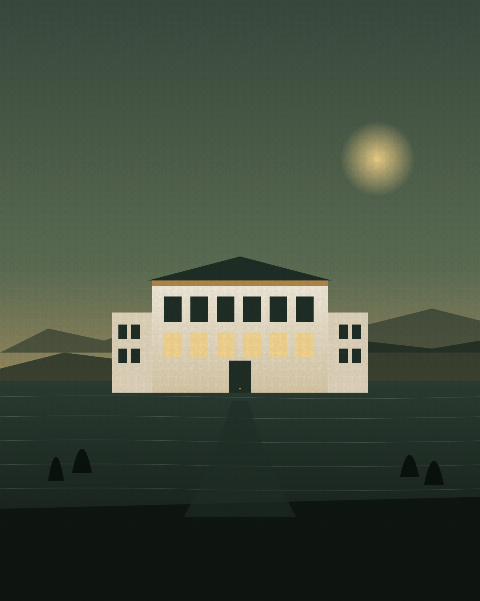

# Talasea — Boutique Hotel HTML Template

A four-page, editorial HTML template for boutique hotels, small inns, and quiet hospitality brands. Forest-green and cream palette with a brass accent. DM Serif Display + Sora typography. Vanilla HTML/CSS/JS — no build step, no framework, no dependencies in the page itself.

## Pages

| File | Purpose |
|---|---|
| `index.html` | Home — cinematic hero, marquee, intro with drop-cap, room bento, dining feature, location, voices, press, CTA |
| `rooms.html` | Six-category room catalog with editorial alternating layout, amenities band, CTA |
| `story.html` | About — long-form narrative, team grid, three values, CTA |
| `contact.html` | Booking inquiry form, direct lines, hand-drawn SVG bay map |

## Quick start

Open `index.html` in any browser. There is no build step.

## Design tokens

All design tokens live in CSS custom properties at the top of `assets/css/styles.css`:

```css
:root {
  --forest:        #1f2e26;
  --cream:         #f3ecdd;
  --brass:         #b08948;
  --ink:           #14181a;
  --moss:          #506b5b;

  --display: 'DM Serif Display', serif;
  --sans:    'Sora', sans-serif;
  --mono:    'JetBrains Mono', monospace;
}
```

Edit those values and the entire theme re-skins.

## Replace images

All visuals under `assets/img/` are labeled SVG placeholders. Each `` tag in the HTML is preceded by a comment with the recommended dimensions:

```html
<!-- REPLACE: hotel exterior at golden hour · 1280×1600 portrait · WebP/JPG -->

```

| File | Where | Recommended |
|---|---|---|
| `hero.svg` | Home cinematic hero | 1280×1600 — exterior at dusk |
| `room-1.svg` … `room-6.svg` | Room cards & catalog | 1000×1250 portrait |
| `dining.svg` | Dining feature | 1000×1200 |
| `location.svg` | Location section | 1000×1250 |
| `story.svg` | Story page hero | 1600×900 landscape |
| `team-1.svg` … `team-3.svg` | Team grid | 800×1000 portrait |
| `avatar-1.svg` … `avatar-3.svg` | Testimonial avatars | 160×160 square |

## Tech

- Vanilla HTML, CSS, vanilla JS (no framework)
- Google Fonts: DM Serif Display, Sora, JetBrains Mono — preconnected
- Responsive: 320 / 480 / 768 / 1024 / 1440+
- Reduced-motion support
- Semantic landmarks, keyboard-visible focus, alt text on every image

## License

Free for personal and commercial use. See html.design license page for details.
